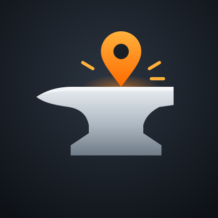

# Anvil

**Android Auto na wyświetlaczu motocykla Kove 800X** · *Android Auto on the Kove 800X display*

Nieoficjalny, darmowy projekt hobbystyczny. Nie jest powiązany z Kove ani z Google.
*Unofficial free hobby project, not affiliated with Kove or Google.*

[Polski](#polski) · [English](#english)

---

## Polski

Anvil pokazuje Android Auto (Mapy Google, Mapy.cz, Waze, muzykę…) na fabrycznym wyświetlaczu Kove 800X.
Telefon udaje radio samochodowe, a obraz trafia na motocykl przez jego Wi‑Fi. Mapa działa także po
wygaszeniu ekranu telefonu przyciskiem zasilania.

### Skąd nazwa Anvil
Na polskim forum Kove 800X nazywa się „kowadło”. Po pierwsze, „Kove” i „kowadło” podobnie brzmią.
Po drugie, motocykl jest solidny, jak prawdziwe kowadło. Anvil to po angielsku „kowadło”
(nie każdy musi to wiedzieć, dla innych jest to oczywiste).

Ikona pokazuje stalowe kowadło, a na nim pomarańczową pinezkę mapy z iskrami. Kowadło to motocykl,
pinezka to nawigacja, czyli to, co robi aplikacja.

### Pobieranie
Plik APK: zakładka **[Releases](https://github.com/MITI374/anvil/releases)**.

### Ustawienia telefonu (raz)
1. Sparuj telefon przez Bluetooth z wyświetlaczem (urządzenie `CQKY…`).
2. Android Auto → na dole 10× dotknij **Wersja** (tryb programisty).
3. Android Auto: włącz **Uruchamiaj Androida Auto bez odblokowywania telefonu**.
4. Raz połącz się ręcznie z Wi‑Fi motocykla – Anvil zapamięta jego nazwę.

**Wi‑Fi motocykla:** jeśli telefon nie jest połączony z żadną siecią Wi‑Fi, Anvil połączy się
z siecią motocykla sam. Jeśli telefon jest w innej sieci (np. domowej), Android go nie przełączy –
przed jazdą wybierz ręcznie sieć motocykla (`CQKY_…`) w ustawieniach Wi‑Fi. Internet dla Map
leci wtedy przez dane komórkowe (włącz „Przełączaj na dane mobilne automatycznie”).

### Jazda
1. Włącz motocykl.
2. Android Auto (Ustawienia → Połączone urządzenia → Android Auto) → **⋮** w prawym górnym rogu →
   **Włącz serwer radioodtwarzacza** (w innych wersjach: „Uruchom serwer jednostki głównej”).
   Przed każdą jazdą. Trzy kropki pojawiają się dopiero w trybie programisty.
3. Anvil → **Tryb samodzielny**. Po 10–20 s Android Auto pojawia się na motocyklu.
4. Raz: ikona **Anvil – dopasowanie ekranu** – suwakami dopasuj obraz do pasków wyświetlacza
   (zielona ramka na motocyklu).

Domyślnie: 720p i DPI 155 (powyżej ok. 157 przestaje działać dotyk w Mapach Google).

### Ograniczenia
- Tylko telefony z Androidem. Wersji na iPhone'a (Apple) nie planuję.
- Wymaga trybu programisty Android Auto; aktualizacja Android Auto może to zepsuć.
- Testowane: Kove 800X, Motorola Edge 50 Ultra, Android 16/17, Android Auto 17.7.

---

## English

Anvil shows Android Auto (Google Maps, Waze, music…) on the Kove 800X's stock TFT. The phone acts as a car
head unit and streams the picture over the motorcycle's Wi‑Fi. The map keeps running with the phone screen off.

**The name:** Polish riders call the Kove 800X *kowadło* – "anvil": it sounds like "Kove", and the bike is
as solid as one. The icon is an anvil with a map pin on it: the motorcycle and the navigation.

**Download:** see **[Releases](https://github.com/MITI374/anvil/releases)**. Android phones only; no iPhone version is planned.

**Setup (once):** pair the phone with the TFT over Bluetooth (`CQKY…`); enable Android Auto developer mode
(tap *Version* 10×); turn on *Start Android Auto while locked*; connect to the motorcycle Wi‑Fi by hand once. If the phone is on another Wi‑Fi (e.g. at home),
switch to the motorcycle network (`CQKY_…`) by hand; with no Wi‑Fi connected, Anvil joins it by itself.

**Ride:** start the bike → Android Auto settings **⋮** → **Start head unit server** (before every ride) → Anvil → **Self mode**.
Use **Anvil – screen fit** once to fit the picture between the TFT's own instrument strips.

---

## How it works / Jak to działa

- The Android Auto receiver is [Open Headunit](https://github.com/andreknieriem/open-headunit) by André Rinas,
  itself based on [Headunit](https://github.com/mikereidis/headunit) by Michael Reid.
- The Kove part (`app/src/main/java/com/andrerinas/openheadunit/kove/`) is Anvil's own code: Bluetooth wake-up,
  the TFT's Wi‑Fi/TCP link, and a decoder → scaler → H.264 encoder that turns the Android Auto stream into the
  TFT's 600×1024 picture.
- The original Open Headunit README is kept as [README.open-headunit.md](README.open-headunit.md).

## License

GNU Affero General Public License v3.0 – see [LICENSE](LICENSE), as for Open Headunit.
Android Auto is a trademark of Google LLC. Kove is a trademark of its owner. Both are used only to describe compatibility.
